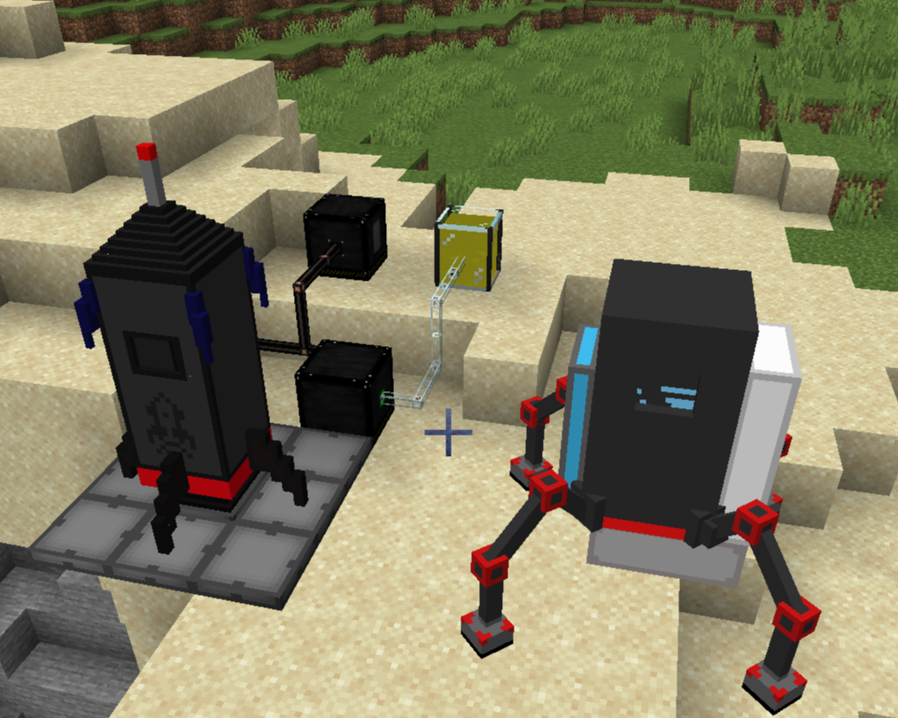

# Heliopause Core

# Overview
Heliopause Core is a tech and space exploration mod where you can build custom machines, launch rockets, and spread the life through solar system. The mod prioritizes aligning with the vanilla experience rather than entirely changing the base game, introducing various QoL features alongside deep industrial mechanics.

Prepare your gears and expand across the solar system. With custom space suits, environmental protections, and additional inventory options, you will be ready for the journey. Build energy and fluid networks to survive: convert crude oil, compress gasses, and run refineries or oxygen sealers using a cohesive tech tree. In the harsh vacuum of space, you can build your base, install life support, and carve out a living space amidst the endless dark.

# Developer's Note
I am a solo developer and not a professional artist, so if the visuals feel a bit basic, that is why. Additionally, recipes and game balance might be a bit off right now. These will be refined during the initial alpha tests.

# The Heliopause Project
Heliopause is planned as a multipart mod series dedicated to complete solar system exploration. Heliopause Core serves as the foundational mod, featuring the Earth, the Moon, and Earth-orbit space stations.

***Future expansions will complete the project:***

**Heliopause Inner Planets:** Venus, Mercury, Mars

**Heliopause Outer Planets:** Jupiter, Saturn, Uranus, Neptune

**Heliopause Beyond:** Dwarf Planets and Asteroid Belts

